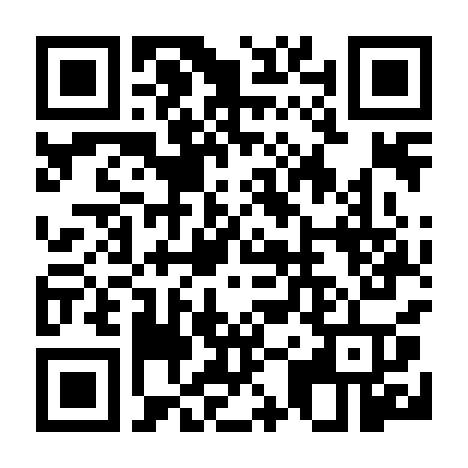

# Bin·Hex·Déc

Application d'entraînement aux conversions **binaire, décimal et hexadécimal** (sur 8 bits) et aux **unités en informatique**, pour les élèves de Bac Pro CIEL et de 2nde MTNE.

**Ouvrir l'application :** https://romainthierry973.github.io/binhexdec/

## Contenu

- Identification de l'élève (nom, prénom, classe)
- Choix d'un ou plusieurs cours : Convertisseur, Décimal → binaire (tableau binaire), Binaire → décimal, Binaire ↔ hexadécimal, Hexadécimal → décimal, Unités en informatique
- Pour les cours choisis : onglets **Cours**, **Exercices** (mélangés, avec indice et correction) et **Évaluation** notée sur 20 (questions mélangées, valeurs de 1 à 255)
- **Évaluation générale** sur tous les cours
- **Mes résultats** : historique des évaluations et moyenne, conservés sur l'appareil

Fonctionne sur ordinateur, tablette et smartphone (Android et iPhone), y compris **hors ligne** une fois installée.

## Installer sur un téléphone

- **Android (Chrome)** : ouvrir l'adresse, menu ⋮, puis « Installer l'application ».
- **iPhone (Safari)** : ouvrir l'adresse, bouton Partager, puis « Sur l'écran d'accueil ».

## Mettre à jour

1. Modifier ou remplacer les fichiers du dépôt.
2. Dans `sw.js`, augmenter le numéro de version, par exemple `const VERSION = "binhexdec-v13";` → `"binhexdec-v14"`.
3. Les appareils récupèrent la nouvelle version à la prochaine ouverture avec du réseau.

Les résultats des élèves restent sur leur appareil : aucune donnée n'est envoyée ni stockée dans ce dépôt.

Polices : Archivo et IBM Plex (licence SIL Open Font License).
